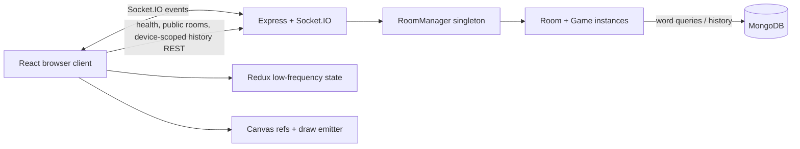
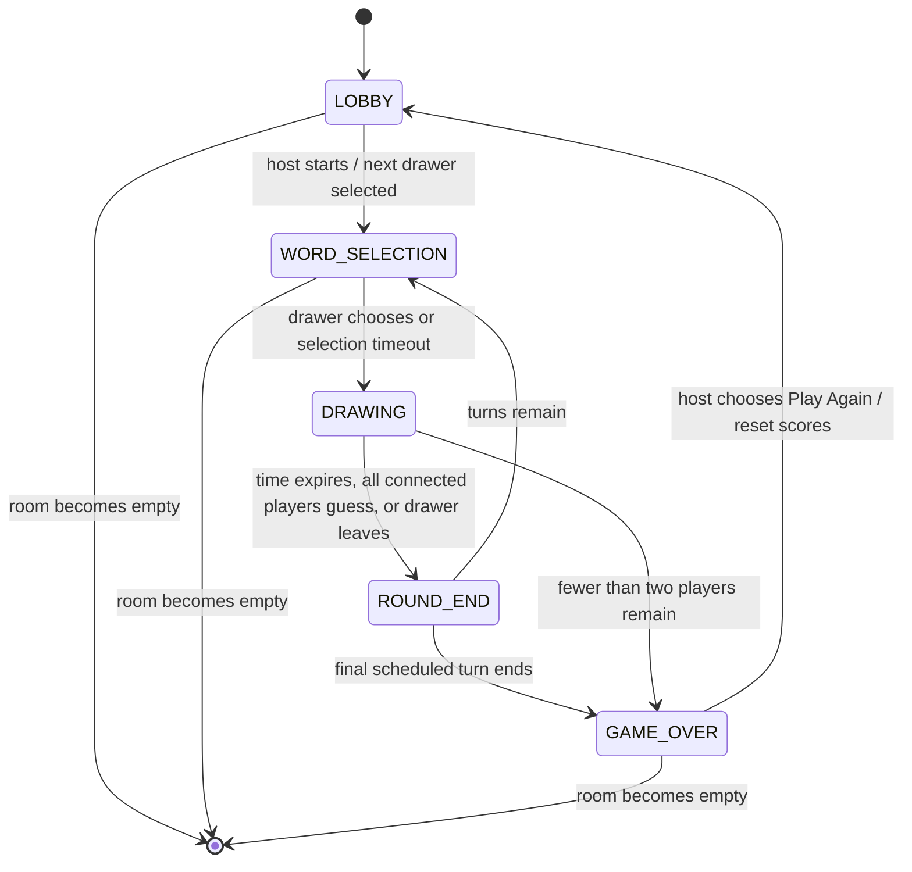
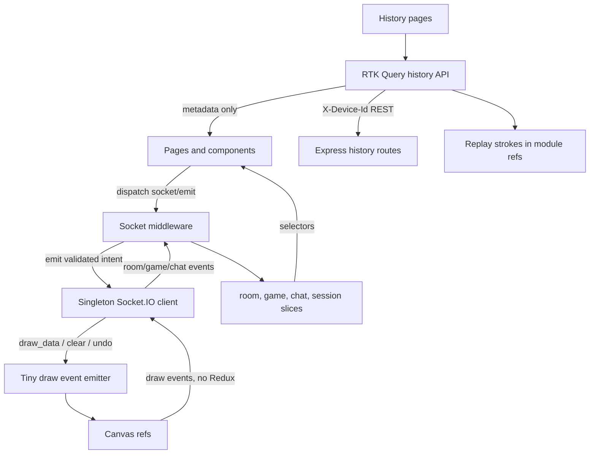

# Architecture

## System at a glance

The application has one source of truth for each kind of state:

- **MongoDB** stores the curated word catalog and optional completed-game records.
- **One Node process** owns live rooms, players, timers, strokes, scores, and secrets through a singleton `RoomManager`.
- **Redux Toolkit** stores low-frequency client presentation state: room snapshots, phase, timer deadline, settings, players, scores, chat, and history metadata.
- **Canvas refs** handle pointer samples and incoming stroke events directly. High-frequency points deliberately bypass Redux.
- **`sessionStorage`** identifies a player within one tab; `localStorage` keeps name/avatar defaults plus a long random device identity used only for history access.



The server sends public snapshots tailored to the recipient. Non-drawers receive blanks and hints, never `currentWord` or word choices. A drawer may receive its own word/options. Authorization is based on the socket's server-side player binding, not a client-supplied player id.

## One complete turn

```mermaid
sequenceDiagram
  autonumber
  participant H as Host client
  participant S as Socket server / Game
  participant D as Drawer client
  participant G as Guesser client
  participant DB as MongoDB / WordService

  H->>S: start_game
  S->>S: verify host and >= 2 players
  S->>DB: request unused word options
  DB-->>S: drawable options
  S-->>D: round_start { options, turnEndsAt }
  S-->>G: game_state { phase: WORD_SELECTION }
  D->>S: word_chosen { word }
  S->>S: verify option; start absolute deadline
  S-->>D: game_state { word, turnEndsAt }
  S-->>G: game_state { blanks, turnEndsAt }
  loop Pointer samples (throttled)
    D->>S: draw_start / draw_move / draw_end
    S->>S: verify drawer; append normalized stroke
    S-->>G: draw_data
  end
  G->>S: guess { text }
  S->>S: normalize, rate-limit, match, score by time
  S-->>G: guess_result { correct: true, points }
  S-->>H: chat_message "G guessed the word!"
  S-->>D: chat_message "G guessed the word!"
  S->>S: all connected guessers done or deadline reached
  S-->>D: round_end { word, scores, nextDrawer }
  S-->>G: round_end { word, scores, nextDrawer }
  S->>S: clear timer; advance queue or finish game
```

Word-selection and turn timers run on the server. Clients render countdowns from the absolute `turnEndsAt`, so latency and refresh do not reset time.

## Game state machine



Every transition clears the timer owned by the previous phase. Room deletion clears every remaining timer. End/remove methods are idempotent because disconnect, explicit leave, and a deadline can race in real networks.

Turn order is a stable drawer queue: every player present at game start draws once per round. Total planned turns are `rounds x players`. A late join is rejected after the game starts, keeping the queue deterministic.

## Completed-game history

At game start, `Game` snapshots the participating player objects and settings. Each completed drawing turn records its drawer, word, scored guesses, drawer points, and final stroke list. Undo and clear therefore need no separate history events. When the game finishes normally or early, the server builds one record only if at least one turn completed and at least one participant supplied a device identity.

History writes are queued after `game_over`; gameplay never waits for MongoDB, and a write failure is logged without changing the result sent to players. The result includes a preallocated `historyId`, allowing the Game Over screen to link directly to details. Coordinates are clamped to 0–1, rounded, deduplicated, and capped per turn and per game. `HISTORY_STORE_STROKES=false` omits replay data while keeping scores and turns. A TTL index on `createdAt` applies `HISTORY_RETENTION_DAYS` retention.

The REST surface is validated, rate-limited, and scoped by the `X-Device-Id` header:

- `GET /api/history` returns cursor-paginated summaries without strokes.
- `GET /api/history/:gameId` returns settings, the device-safe leaderboard, turns, and optional strokes only when that device participated.
- `DELETE /api/history/:gameId` revokes that device's access to one record.
- `DELETE /api/history` revokes that device's access to every record.

Access revocation removes only the private device identifier, not the corresponding historical leaderboard row. The document is deleted after its final device access is revoked. REST payloads never expose any device identifier and use private, no-store cache headers.

## Reconnect and duplicate-session flow

```mermaid
sequenceDiagram
  participant C1 as Existing tab
  participant S as Server
  participant C2 as Refreshed or duplicate tab

  C1--xS: transport disconnects
  S->>S: mark player disconnected; start grace timer
  S-->>C2: socket connect
  C2->>C2: read matching sessionStorage record
  C2->>S: rejoin_room { roomId, playerId }
  S->>S: find only; cancel removal timer
  alt old socket is still connected
    S-->>C1: session_replaced
    S->>C1: disconnect old socket
  end
  S->>S: bind new socket; join Socket.IO room
  S-->>C2: full recipient-safe snapshot + chat + strokes
  S-->>C1: player_updated (through room broadcast)
```

If no rejoin arrives before the grace period, the normal removal flow runs: reassign the host if needed, end an abandoned drawer's turn, finish a game with fewer than two players, and delete an empty room. Refresh and tab close never emit `leave_room`; the explicit Leave control does.

## Server responsibilities

- `Player` keeps identity, current socket, score, flags, and the pending removal timer.
- `Room` owns settings and its player map, chooses/reassigns the host, broadcasts, and creates recipient-specific snapshots.
- `Game` owns the phase machine, drawer queue, current secret, hints, deadlines, scoring deltas, and stroke history.
- `RoomManager` is the sole map from six-character room code to `Room`; joining a missing code never creates it.
- `WordService` selects unused words, merges validated custom words, and supports the configured word mode.
- `MessageHandler` and the focused socket handlers validate zod payloads, resolve the bound player, enforce permissions, and return structured errors.

Live state intentionally remains in memory. This makes timer ownership, secrets, and cleanup visible enough for an intern to trace. A process restart ends live rooms; persistence/recovery would require a materially more complex distributed state design.

## Client data flow



The socket is constructed once with `autoConnect: false` and connected at the application root. Effects remove only the listener functions they registered; they do not disconnect the singleton during React Strict Mode cleanup.

Room routes hydrate themselves. On each socket connection, a route with a matching saved session attempts `rejoin_room`; otherwise an invite link presents/uses the fresh join flow. Redux being empty is not proof that a server room is missing.

RTK Query caches history summaries and detail metadata. Detail responses are transformed before entering Redux: stroke arrays move to a module-local replay cache and `ReplayCanvas` reads them into refs. Progressive `requestAnimationFrame` playback therefore does not put high-frequency drawing data or animation state into Redux.

## Drawing model

The logical board is 800 x 600 (4:3). Pointer coordinates are normalized to 0–1 using a fresh bounding rectangle per event, so points survive different CSS sizes and orientations. Rendering scales the logical canvas for CSS size and `devicePixelRatio` for crisp pixels.

The drawer uses Pointer Events, pointer capture, coalesced events where available, and a roughly frame-rate throttle for moves. Only the canvas has `touch-action: none`, and only while relevant controls consume drawing gestures; the rest of the page remains scrollable. The server accepts samples solely from the active drawer and stores strokes. Undo removes one completed stroke, while clear empties history. Resize, reconnect, undo, and clear redraw from the authoritative history.

Draw points bypass Redux because dozens of actions per second would create allocations, subscriber notifications, DevTools noise, and avoidable React work. A ref plus a small event emitter is a better fit for transient rendering; Redux retains tool/color/size because those change infrequently and affect UI.

## Guessing, visibility, and scoring

`wordMatcher` trims input, lowercases it, and collapses internal whitespace before exact comparison. For words longer than four characters, Levenshtein distance one yields a private “close” response without revealing the word. Correct guesses become a generic public system message. Guessed-player chat is scoped to guessed players and the drawer so it cannot leak hints to active guessers.

The server calculates points using remaining server time. A quick guess starts near `100 + floor(500 * timeLeft / drawTime)` and applies a small guess-order decay. The drawer earns points based on how many eligible players guessed. All-guessed early completion considers connected non-drawers only.

## Stable wire shapes

Important payloads use explicit primitives so React never receives an opaque class instance:

```js
// Player
{ id, name, avatar, score, isHost, isConnected, hasGuessed }

// Round end
{ word, scores: [{ playerId, name, avatar, delta, total }], nextDrawer }

// Game over
{
  winner: { playerId, name, score },
  leaderboard: [{ rank, playerId, name, avatar, score }],
  historyId // present when a completed turn is eligible for history
}

// Error
{ code, message }
```

All socket inputs cross zod schemas. Settings ranges, drawer/host identity, score, and time are checked or derived again on the server.

## Deployment constraints and growth path

The current server must run as one persistent process. Vercel is appropriate for the static client but its serverless functions are not the right home for long-lived Socket.IO connections or process-local game rooms. Render or Railway can host the Node server; Atlas hosts MongoDB.

Atlas must have enough space for the chosen retention and replay policy. Confirm the history TTL index after deployment, monitor free-tier storage, and update the existing index if `HISTORY_RETENTION_DAYS` changes. Disabling `HISTORY_STORE_STROKES` substantially reduces completed-game storage without disabling history itself.

To scale beyond one process:

1. Put a load balancer with sticky sessions in front of the Socket.IO nodes.
2. Add the Socket.IO Redis adapter for cross-node event delivery.
3. Move room/game state, locks, deadlines, and idempotency records to a shared store.
4. Replace in-process timers with durable scheduled jobs or deadline reconciliation.
5. Add authenticated accounts, moderation, observability, and abuse controls.

Adding only a Redis event adapter is insufficient: two processes could still mutate separate copies of one game.

## How to explain this code in an interview

- **WebSockets:** HTTP handles health/public discovery; Socket.IO carries bidirectional room, game, chat, and drawing events. Acknowledgements give create/join/rejoin immediate structured results.
- **Authority:** the browser sends intent, never facts such as “I am the drawer” or “award me 500 points.” The server resolves identity from the socket and computes the result.
- **Strokes:** clients send normalized pointer samples; the server stores a compact history and rebroadcasts it, enabling resize and reconnect replay.
- **Game state:** a small explicit phase machine owns deadlines and cleanup. Absolute timestamps keep reconnected clients synchronized.
- **Redux middleware:** components dispatch one generic outgoing action, while middleware translates incoming socket events into ordinary slice actions. UI stays testable without embedding socket code everywhere.
- **Why drawing skips Redux:** frame-frequency samples are imperative rendering data, not durable application UI state; refs prevent needless store/render churn.
- **Word matching:** pure normalization and edit-distance functions are easy to unit-test and do not expose the secret in public responses.
- **Reconnects:** per-tab session ids let a new socket reclaim an existing server player during a grace window; a duplicate session replaces the old transport rather than duplicating the player.
- **History privacy:** a separate persistent device id grants REST access without accounts, never appears in public payloads, and can be revoked without changing another player's view of the leaderboard.
- **Deployment:** the static React bundle can be globally hosted, while the stateful WebSocket server needs a persistent process. Horizontal scale requires shared state, not merely more instances.
